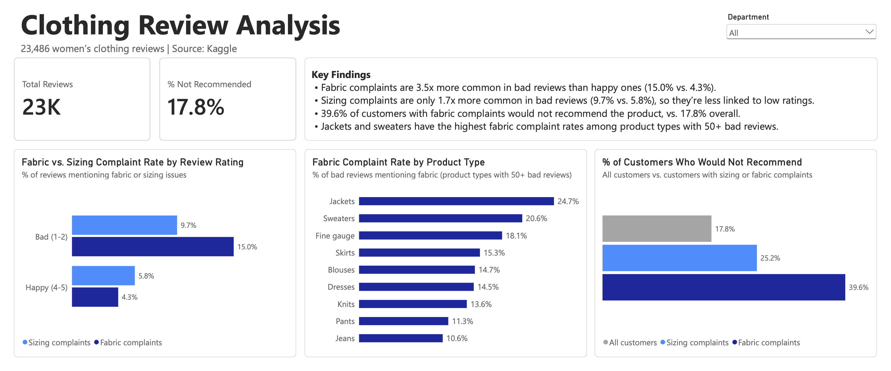
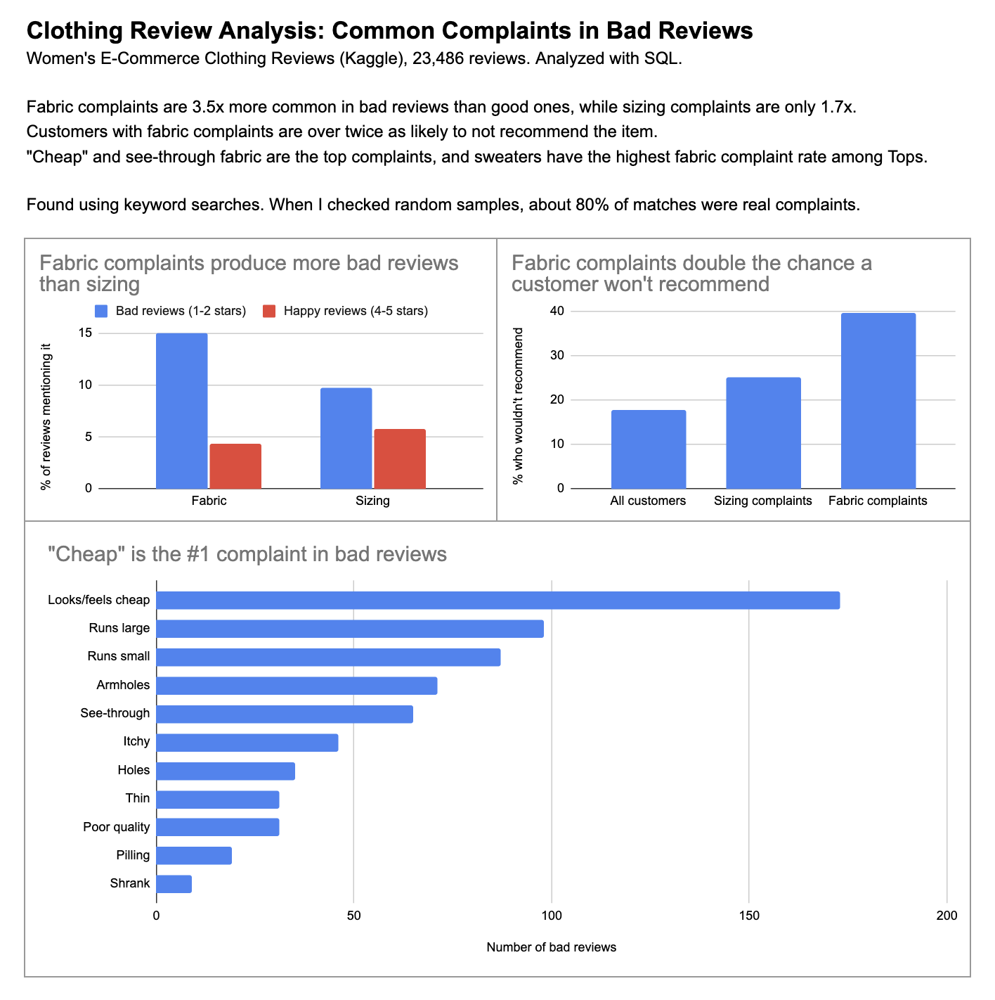

# Clothing Review Analysis

What are the common complaints in bad reviews on an online clothing store? I used SQL to analyze 23,486 customer reviews to find which complaints are most associated with low ratings, then rebuilt the analysis as an interactive Power BI dashboard.

## Dashboards

**Power BI**

[Power BI file (.pbix)](clothing_review_dashboard.pbix) | [PDF](clothing_review_dashboard.pdf)

**Google Sheets**

[Open in Google Sheets](https://docs.google.com/spreadsheets/d/1bJFrMr7xxGVRH-3CAEHQSVkY3ScJIu_n8PR3xwkEYrY/edit?usp=sharing)

## Data

[Women's E-Commerce Clothing Reviews](https://www.kaggle.com/datasets/nicapotato/womens-ecommerce-clothing-reviews) (Kaggle). Each review includes a star rating, whether the customer would recommend the item, the department and product type, and the review text.

I compared low-rated reviews (1-2 stars, 2,407 reviews) with high-rated reviews (4-5 stars, 18,208 reviews).

**Tools:** SQLite (DB Browser for SQLite), Google Sheets, Power BI (Power Query, DAX)

## Findings

1. **Fabric is more closely tied to bad reviews than sizing.** Fabric complaints appear about 3.5x more often in bad reviews than good ones (15% vs 4.3%). Sizing complaints appear only about 1.7x more often (9.7% vs 5.8%).
2. **Customers with fabric complaints are the least likely to recommend.** 39.6% of customers with fabric complaints wouldn't recommend the item, compared to 25.2% with sizing complaints and 17.8% overall.
3. **Customers mostly complain about how fabric looks and feels.** "Cheap" is the top complaint in bad reviews (173), followed by see-through fabric (65). Holes, pilling, and shrinking are much less common.
4. **Sweaters have the biggest fabric problem in Tops.** Bad-review rates are similar across departments (8-11%), but sweaters have the most fabric complaints among bad reviews in Tops (20.6%).
5. **Jackets have the highest fabric complaint rate.** 24.7% of bad jacket reviews mention fabric
